# 🤖 Friday — Complete System Documentation

> **Version:** 2.0 · **Library:** discord.py · **Language:** Python 3 · **Architecture:** Modular Cog System · **Dashboard:** Flask Web Control Center
> **Source:** [`main.py`](file:///c:/Users/vinod/OneDrive/Desktop/Projects/Discord%20bot%20(Friday)/main.py) · [`Friday.py`](file:///c:/Users/vinod/OneDrive/Desktop/Projects/Discord%20bot%20(Friday)/Friday.py)

---

## 🌟 What is Friday?

**Friday** is a high-performance, general-purpose Discord companion, security guardian, and server automation engine. She combines:
- **Enterprise Server Defense:** Multi-tier Anti-Nuke, high-speed Anti-Raid velocity tracking, duplicate flood Anti-Spam protection, and 10 automatic audit log channels.
- **Conversational Intelligence:** High-uptime LLM chat engine (Groq, OpenRouter, Google Gemini) featuring conversational memory, live Google news search, user persona learning, server instructions, and safety guardrails.
- **Member Care & Welcome:** First-message welcome greeting detection for newly joined members, and an intelligent AFK tracker with automatic `[AFK]` nickname prefixing and missed ping tracking.
- **Precision Keyword & Mention Auto-Responder:** Strict word-boundary matching engine preventing substring false positives (e.g. matching `ip` but never `IPL`), paired with custom reaction emoji dispatches and channel exemptions.
- **Pure YouTube Audio Engine:** High-fidelity 48kHz music streaming strictly from YouTube official releases with live autocomplete and real-time DSP Equalizer switching.
- **Unified Web Control Center:** Sleek dark-mode dashboard running locally at `http://localhost:5000` with an authentic Discord simulator, real-time sync, and the **Universal Visual Rich Emoji Editor** displaying actual emoji images in all text inputs.

Friday operates with a **persistent JSON database** ([`friday_memory.json`](file:///c:/Users/vinod/OneDrive/Desktop/Projects/Discord%20bot%20(Friday)/friday_memory.json)), ensuring all server configurations, XP leaderboards, security limits, ticket panels, first-welcome settings, and auto-responder rules survive bot restarts and reboots. Every setting is strictly isolated per Discord Guild.

---

## 🏛️ System Architecture & Layered Hierarchy

Friday is built on a modular 15-cog architecture loaded dynamically on startup via [`main.py`](file:///c:/Users/vinod/OneDrive/Desktop/Projects/Discord%20bot%20(Friday)/main.py), paired with an asynchronous Flask Web Dashboard running in a background daemon thread sharing the unified [`database.py`](file:///c:/Users/vinod/OneDrive/Desktop/Projects/Discord%20bot%20(Friday)/database.py) instance.

```mermaid
graph TD
    M["main.py — Core Engine"] --> DB["Persistent Database<br/>database.py / friday_memory.json"]
    M --> WB["Flask Web Control Center<br/>dashboard/app.py (Port 5000)"]
    M --> COGS["Modular Extensions (cogs/)"]

    COGS --> C1["🛡️ cogs.moderation"]
    COGS --> C2["⚙️ cogs.security (Anti-Nuke/Raid/Spam)"]
    COGS --> C3["🤖 cogs.ai_chat (Groq/OpenRouter/Gemini)"]
    COGS --> C4["💤 cogs.afk (Status & Ping Tracking)"]
    COGS --> C5["👋 cogs.welcomer (First Welcome Engine)"]
    COGS --> C6["🎨 cogs.expressions (Autoresponder & Reactions)"]
    COGS --> C7["🔒 cogs.privacy (Lockdown & Channel Protection)"]
    COGS --> C8["🤬 cogs.anti_abuse (Chat Word Filter)"]
    COGS --> C9["🎉 cogs.leveling (XP & Milestone Cards)"]
    COGS --> C10["🎭 cogs.reaction_roles (Panel Dispatcher)"]
    COGS --> C11["🎫 cogs.tickets (HTML Archiving & Routing)"]
    COGS --> C12["📢 cogs.announcements (Self-Broadcaster)"]
    COGS --> C13["🖼️ cogs.media (Media-Only Enforcement)"]
    COGS --> C14["🎵 cogs.music (Pure YouTube Audio Engine)"]
    COGS --> C15["📊 cogs.utility (Latency, Jokes & Sync)"]
```



### Layered Permissions Model
- **👑 Server Owner & Administrators:** Complete control over Anti-Nuke thresholds, server-wide AI instructions, security audit generation, channel lockdowns, and whitelist assignments.
- **🛡️ Staff & Moderators (`Manage Messages` / `Moderate Members`):** Day-to-day enforcement, warnings, timeouts, bans, purges, auto-responder rules, and announcement broadcasts.
- **👥 Server Members:** Natural AI conversation, AFK mode, music playback, rank cards, leaderboard inspection, and Hinglish joke queries.

---

## 🗂️ Complete Feature Breakdown

---

### 1. 🛡️ Moderation Commands
The moderation toolkit enforces Discord's role hierarchy to prevent abuse (moderators cannot punish members with equal or higher roles). All actions are logged into Friday's security audit channels.

| Command | Syntax & Options | Description | Permission Required |
|---|---|---|---|
| `/ban` | `@member [reason]` | Permanently bans a member from the server | `Ban Members` |
| `/unban` | `<user> [reason]` | Unbans a user by username, tag, or numeric ID with live autocomplete | `Ban Members` |
| `/warn` | `@member [reason] [delivery]` | Issues a formal warning (`delivery`: Both, DM Only, or Channel Chat) | `Moderate Members` |
| `/warnings` | `@member` | Displays all active warning IDs, timestamps, and reasons for a member | `Moderate Members` |
| `/clearwarns` | `@member [warn_id]` | Clears all warnings or a specific warning ID for a member | `Moderate Members` |
| `/timeout` | `@member <minutes> [reason]` | Applies a temporary timeout (mute) to a member | `Moderate Members` |
| `/untimeout` | `@member [reason]` | Lifts an active timeout from a member early | `Moderate Members` |
| `/purge` | `<amount>` | Bulk-deletes messages (1–100) in the current channel | `Manage Messages` |
| `@Friday` | `@member <new nickname>` | Changes a user's nickname (requires Manage Nicknames permission) | `Manage Nicknames` |

---

### 2. ⚙️ Anti-Nuke, Anti-Raid & Security Command Center
Friday's multi-layered defense system safeguards the server against compromised staff accounts, rogue bots, raid attacks, and spam floods.

#### Security Layers:
1. **Limit & Punish:** Enforces penalties (Ban, Kick, Strip Roles, Timeout) when destructive actions exceed thresholds in a rolling 60-second window (Mass Ban, Mass Kick, Role Create/Delete, Channel Create/Delete, Mention Spam).
2. **Instant Punishment:** Immediate enforcement upon detecting unauthorized bot additions, mass pruning, dangerous administrator permissions, vanity URL modifications, server renames, server icon alterations, role/channel renames, emoji deletion/renaming, and invite deletions.
3. **Detect Only:** Auto-deletes and silently logs Discord invite link spam and ghost pings.
4. **Anti-Raid Velocity Tracking:** Monitors member join velocity (e.g. >5 joins in 10 seconds). Exceeding thresholds triggers quarantine lockdown and alerts `#audit-antiraid`.
5. **Anti-Spam Flood Filter:** Detects message bursts (>5 messages in 4 seconds) or duplicate message flooding (>3 repeated messages), automatically purges offending messages, applies a 10-minute timeout, and alerts `#audit-antispam`.
6. **10 Dedicated Audit Channels:** Auto-created and organized under the "Friday Security Logs" category:
   - `#audit-antiraid`, `#audit-antispam`, `#audit-roles`, `#audit-channels`, `#audit-antinuke`
   - `#audit-banned`, `#audit-deleted`, `#audit-timeouts`, `#audit-whitelisted`, `#audit-abuse`

| Command | Syntax & Options | Description | Permission Required |
|---|---|---|---|
| `/antinuke_toggle` | `<ON/OFF>` | Master switch enabling or disabling automated security punishments | `Administrator` |
| `/antiraid` | `<enable/disable>` | Toggle high-speed mass join velocity tracking & auto-quarantine | `Administrator` |
| `/antispam` | `<enable/disable>` | Toggle rapid message burst and duplicate flood filter | `Administrator` |
| `/security_status` | *None* | Comprehensive overview of all 10 security audit channels & matrices | `Administrator` |
| `/antinuke_limit` | `<action> <limit>` | Sets threshold limits for destructive actions within a 60-second window | `Administrator` |
| `/antinuke_refresh` | *None* | Auto-creates the "Friday Security Logs" category and all 10 audit channels | `Administrator` |
| `/antinuke_sync` | *None* | Auto-scans and re-links existing security audit channels across the server | `Administrator` |
| `/whitelist_add` | `@user` | Makes a user completely immune to anti-nuke, anti-raid, and anti-spam actions | `Administrator` |
| `/whitelist_remove` | `@user` | Revokes a user's security immunity | `Administrator` |

---

### 3. 🤖 AI Conversational Assistant & Natural Language Engine
Powered by [`cogs/ai_chat.py`](file:///c:/Users/vinod/OneDrive/Desktop/Projects/Discord%20bot%20(Friday)/cogs/ai_chat.py), Friday features a resilient, multi-provider LLM pipeline with high uptime, charming personality, and deep server awareness.

#### Multi-Tier LLM Fallback Pipeline:
- **Groq (Ultra-Fast Primary):** `llama-3.3-70b-versatile`, `llama-3.1-8b-instant`, `qwen/qwen3.8-27b`, `openai/gpt-oss-120b`, `openai/gpt-oss-20b`.
- **OpenRouter (High-Capacity Free Tier):** `google/gemma-4-26b-a4b-it:free`, `nvidia/nemotron-3-super-120b-a12b:free`, `liquid/lfm-2.5-2.6b:free`, `google/gemma-4-31b-it:free`, `nvidia/nemotron-3.5-super-vl:free`.
- **Google Gemini (Resilient Fallback):** `gemini-2.5-flash`, `gemini-2.5-flash-lite`, `gemini-3.5-flash`.

#### Core Features:
1. **Conversational Memory:** Maintains a rolling multi-turn memory session (up to 8 messages) per user/channel. Replying to Friday's messages or tagging her continues the conversation seamlessly.
2. **Real-Time Google News & Live Search:** Automatically detects search intent (news, cricket scores, crypto prices, world events) and queries Google News RSS in real-time, injecting verified summaries into the LLM context.
3. **Smart Date & Time Handling:** Direct queries regarding current date, time, day, or year are resolved instantly using the host's real-time clock without triggering unnecessary web searches or hallucinations.
4. **Persona Learning:** Gently learns positive personal facts, favorite games, hobbies, and preferences during casual chat (e.g. "I love Valorant", "My favorite color is emerald"), saving them to `db.user_memories` to personalize future interactions.
5. **Server Instructions:** Server Owners and Admins can configure custom behavioral rules (e.g., "Always welcome gamers warmly" or "Speak in casual Hinglish"), which are dynamically embedded into Friday's system prompt.
6. **Community Safety & Moderation Guardrails:**
   - Blocks severe 18+/NSFW profanity patterns with a polite request to keep chat clean.
   - Gracefully declines requests to take moderation actions (kick, ban, mute, purge), reminding users that Friday is a companion and directing them to human staff.
   - **Mention Sanitization:** Strips raw `@everyone`, `@here`, and mass ping syntax to prevent ping abuse.

| Command | Syntax & Options | Description | Permission Required |
|---|---|---|---|
| `/ask` | `<question>` | Direct slash command to ask Friday anything with her charming personality | Everyone |
| `/clearchat` | *None* | Resets recent multi-turn conversation memory with Friday in the channel | Everyone |
| `/mymemory` | `<action: view/clear>` | Views or clears personal persona facts Friday has learned about you | Everyone |
| `/server_instruction` | `<action: add/view/clear> [instruction]` | Configures server-wide custom behavioral instructions for Friday | `Administrator` |
| In-Chat Mention | `@Friday <message>` or Reply | Triggers intelligent conversational response with multi-turn context | Everyone |

---

### 4. 💤 Member AFK & Ping Tracking System
Managed by [`cogs/afk.py`](file:///c:/Users/vinod/OneDrive/Desktop/Projects/Discord%20bot%20(Friday)/cogs/afk.py), this module manages away statuses, alerts taggers, and saves missed mentions.

#### Core Behavior:
- **Nickname Prefixing:** Automatically prepends `[AFK] ` to the member's server nickname upon setting AFK, and seamlessly restores their original nickname when they return.
- **Mention Notifications:** When another member mentions or replies to an AFK user, Friday sends a notification embed displaying the away duration (`<t:time:R>`) and reason.
- **Missed Pings Summary:** Captures all pings while the user is away, recording the author, channel, and direct `[Jump to Message]` URLs.
- **Welcome Back Notification:** Upon the user's return (sending any message in the server), Friday removes their AFK status, reverts their nickname, and presents a compact summary of missed pings.
- **Autoresponder Deconfliction:** If a mentioned user has an active auto-responder rule, the auto-responder is temporarily suppressed while they are AFK so users receive only the relevant away notice.

| Command | Syntax & Options | Description | Permission Required |
|---|---|---|---|
| `/afk` | `[reason]` | Sets your AFK status with an optional reason (e.g. Studying, Lunch, Sleeping) | Everyone |

---

### 5. 👋 First Message Welcome Engine
Managed by [`cogs/welcomer.py`](file:///c:/Users/vinod/OneDrive/Desktop/Projects/Discord%20bot%20(Friday)/cogs/welcomer.py), Friday greets new members on their **very first message** in the server.

#### Core Behavior:
- **First Message Detection:** Monitors incoming messages and greets members who joined the server within the last 7 days upon posting their first-ever chat message.
- **Customizable Embed:** Displays a sleek box embed with the user's avatar thumbnail, personalized server title, and welcome text.
- **Dynamic Template Variables:** Supports `{user}`, `{username}`, `{name}`, `{server}`, `{member_count}`, and `{channel}`.
- **Theme Color Accents:** Selectable presets (`success`, `info`, `warning`, `danger`) or custom hex codes (e.g. `#10b981`).
- **Dashboard Studio Integration:** Fully configurable via the Web Control Center with real-time card previews and live test dispatch.

| Command | Syntax & Options | Description | Permission Required |
|---|---|---|---|
| `/first_welcome set` | `[channel]` | Sets the destination welcome channel (defaults to current channel if blank) | `Administrator` |
| `/first_welcome disable` | *None* | Disables first-message welcome greetings for this server | `Administrator` |
| `/first_welcome status` | *None* | Views current configuration, destination channel, and theme colors | `Administrator` |
| `/first_welcome test` | *None* | Dispatches an authentic test welcome card to preview formatting | `Administrator` |
| `/first_welcome message` | `<template>` | Updates the welcome message format using template variables | `Administrator` |
| `/first_welcome reset` | `[member]` | Clears welcome history for a member or all members to re-trigger greetings | `Administrator` |
| `/set_welcomer` | `[mode] [channel]` | Shortcut command to set welcome channel (leave empty for current channel) | `Administrator` |
| `/set_first_welcome` | `[channel]` | Standalone shortcut to set first-welcome destination to current channel | `Administrator` |

---

### 6. 🎨 Expressions, Reactions & Keyword Auto-Responder
Managed by [`cogs/expressions.py`](file:///c:/Users/vinod/OneDrive/Desktop/Projects/Discord%20bot%20(Friday)/cogs/expressions.py), this module powers emoji theft, auto-reactions on mention, and keyword-triggered automated responses.

#### Precision Word Boundary Engine:
- **Standalone Keyword Matching:** Uses strict regular expressions `(?<!\w){re.escape(trigger)}(?!\w)` so that words like `ip` trigger on `"what is the ip?"` or `"send ip please"`, but **strictly never** trigger on substrings like `"IPL"` or `"equipment"`.
- **Reaction Emoji Pairing:** Rules can optionally attach an emoji reaction (custom server emoji or standard Unicode) that Friday will automatically add to the triggering message.
- **Channel Exemptions:** Channels can be exempted using `/autoresponder ignore_channel` to keep busy or serious channels clean.
- **Supported Variables:** Reply templates support `{author}` (triggering author mention) and `{user}` (target member name).

| Command | Syntax & Options | Description | Permission Required |
|---|---|---|---|
| `/emoji_steal` | `<emojis>` | Paste one or more custom emojis to bulk-steal and add them to the server | `Manage Expressions` |
| Context Menu | Right-Click Message → Apps → Steal Sticker | Instantly steals a sticker from any message and uploads it to server | `Manage Expressions` |
| `/autoreact add` | `@member <emoji>` | Automatically reacts with an emoji whenever `@member` is tagged | `Manage Guild` |
| `/autoreact remove`| `@member` | Removes the auto-reaction rule for `@member` | `Manage Guild` |
| `/autoreact list` | *None* | Lists all active auto-reaction mention rules | Everyone |
| `/autoresponder add` | `<response> [member] [keyword] [emoji]` | Creates an automated reply/reaction when a member is tagged OR a word is typed | `Manage Guild` |
| `/autoresponder remove` | `[member] [keyword]` | Removes an auto-responder rule by member mention or keyword | `Manage Guild` |
| `/autoresponder list` | *None* | Lists all active auto-responder rules (mentions and keywords) and ignored channels | Everyone |
| `/autoresponder ignore_channel` | `#channel` | Disables auto-responder triggers in the specified channel | `Manage Guild` |
| `/autoresponder unignore_channel` | `#channel` | Re-enables auto-responder triggers in an ignored channel | `Manage Guild` |

---

### 7. 🔒 Channel Privacy & Lockdown System
Managed by [`cogs/privacy.py`](file:///c:/Users/vinod/OneDrive/Desktop/Projects/Discord%20bot%20(Friday)/cogs/privacy.py), this system enables rapid lockdown during emergencies while protecting critical audit channels.

| Command | Syntax & Options | Description | Permission Required |
|---|---|---|---|
| `/private` | `[channel]` | Hides a specific channel from `@everyone` | `Manage Channels` |
| `/unprivate` | `[channel] [all_channels]` | Restores channel visibility for a specific channel or ALL channels | `Manage Channels` |
| `/private_category` | `<category>` | Hides an entire category and all contained channels | `Manage Channels` |
| `/unprivate_category`| `<category>` | Unhides an entire category and all contained channels | `Manage Channels` |
| `/ignore_private_add`| `<channel>` | Adds a channel to the lockdown exemption list | `Manage Channels` |
| `/ignore_private_remove`| `<channel>` | Removes a channel from the lockdown exemption list | `Manage Channels` |
| `/force_private` | *None* | Emergency Lockdown: Hides all channels except exempt channels (which become Read-Only) | `Manage Channels` |

---

### 8. 🤬 Anti-Abuse Chat Filter
Managed by [`cogs/anti_abuse.py`](file:///c:/Users/vinod/OneDrive/Desktop/Projects/Discord%20bot%20(Friday)/cogs/anti_abuse.py), scans both newly sent messages and edited messages against a custom blacklist.

| Command | Syntax & Options | Description | Permission Required |
|---|---|---|---|
| `/anti_abuse` | `<words>` | Adds words to the filter (comma-separated list) | `Manage Messages` |
| `/anti_abuse_remove` | `<word>` | Removes a specific word from the filter | `Manage Messages` |
| `/anti_abuse_list` | *None* | Displays all currently filtered words | `Manage Messages` |
| `/anti_abuse_whitelist_add` | `@user` | Grants a member immunity from the word filter | `Manage Messages` |
| `/anti_abuse_whitelist_remove` | `@user` | Revokes a member's filter immunity | `Manage Messages` |

---

### 9. 🎉 Community, XP & Leveling
Managed by [`cogs/leveling.py`](file:///c:/Users/vinod/OneDrive/Desktop/Projects/Discord%20bot%20(Friday)/cogs/leveling.py), rewards active chatting with 15–40 XP per message (60-second cooldown).

#### Notification Modes:
1. **Text Only:** Sends a formatted markdown congratulatory announcement.
2. **Image Card Only:** Generates and uploads a high-resolution PIL graphical milestone badge card.
3. **Both (Text + Image Card):** Sends the custom text message together with the attached milestone card.

| Command | Syntax & Options | Description | Permission Required |
|---|---|---|---|
| `/level_setup` | `#channel` | Activates leveling and designates the level-up update channel | `Manage Channels` |
| `/level_mode` | `<text/image/both>` | Selects notification dispatch mode (Text, Image Card, or Both) | `Manage Channels` |
| `/rank` | `[@user]` | Generates and displays a custom graphical rank card | Everyone |
| `/leaderboard` | *None* | Displays the top 10 most active server members | Everyone |

---

### 10. 🎭 Reaction Roles
Managed by [`cogs/reaction_roles.py`](file:///c:/Users/vinod/OneDrive/Desktop/Projects/Discord%20bot%20(Friday)/cogs/reaction_roles.py), provides interactive self-assignable role panels.

| Command | Syntax & Options | Description | Permission Required |
|---|---|---|---|
| `/reaction_panel` | *Interactive* | Creates an embed panel supporting up to 3 emoji-role pairs | `Manage Roles` |

---

### 11. 🎫 Interactive Ticket System
Managed by [`cogs/tickets.py`](file:///c:/Users/vinod/OneDrive/Desktop/Projects/Discord%20bot%20(Friday)/cogs/tickets.py), provides secure support channel provisioning with authenticated HTML transcript delivery.

- **Dynamic Action Buttons:** Soft rounded Discord buttons (`border-radius: 8px`) with leading emoji icons.
- **Isolated Channels:** Creates private channels (`#ticket-001-general-support`) hidden from regular members.
- **Support Staff Routing:** Automatically pings and grants access to designated support staff roles.
- **Direct Transcript Text Channel:** Delivers full HTML chat transcripts directly to a designated log channel upon closing.

| Command | Syntax & Options | Description | Permission Required |
|---|---|---|---|
| `/ticket create_ticket_panel` | `<channel> <title> <desc> ...` | Deploys an interactive support panel with dynamic buttons | `Administrator` |
| `/ticket handle_role` | `<role>` | Designates the support staff role to be granted ticket access | `Administrator` |
| `/ticket add` | `@user` | Grants a specific user access to an active ticket channel | `Manage Channels` |
| `/ticket remove` | `@user` | Revokes a specific user's access from an active ticket channel | `Manage Channels` |

---

### 12. 📢 Self Announcements Dispatcher
Managed by [`cogs/announcements.py`](file:///c:/Users/vinod/OneDrive/Desktop/Projects/Discord%20bot%20(Friday)/cogs/announcements.py), streamlines server announcements.

| Command | Syntax & Options | Description | Permission Required |
|---|---|---|---|
| `/announcement` | `<channel>` | Sets or overwrites the official announcement destination channel | `Manage Channels` |
| In-Chat Reply Shortcut | Tag `@Friday announcement kardo` | Reply to any draft message to broadcast it with embeds & attachments | `Manage Messages` |

---

### 13. 🎵 High-Fidelity Music (Pure YouTube Engine)
Managed by [`cogs/music.py`](file:///c:/Users/vinod/OneDrive/Desktop/Projects/Discord%20bot%20(Friday)/cogs/music.py), powered by `yt-dlp` and `FFmpeg`.

- **Pure YouTube Audio Search:** Queries official releases and verified artist channels exclusively.
- **Real-Time Autocomplete:** Google Search suggestion API integration providing suggestions in under 500ms.
- **Interactive Controller Views:** Balanced 2-row button grid (Pause/Resume, Skip, Shuffle, Loop, Stop, Queue, Like, Vol -, Vol +) and a DSP Equalizer dropdown.
- **Seamless Real-Time EQ Switching:** 8 DSP presets (`Studio Master`, `Bass Boost`, `Vocal Boost`, `Nightcore`, `Lo-Fi`, `Treble Boost`, `8D Spatial Audio`, `Flat`) applied without restarting playback from 0:00 (seeks seamlessly using `-ss`).

| Command | Syntax & Options | Description | Permission Required |
|---|---|---|---|
| `/join` | *None* | Connects Friday to the user's voice channel | Everyone in VC |
| `/leave` | *None* | Stops playback, clears queue, and disconnects Friday | Everyone in VC |
| `/play` | `<music>` | Searches and streams audio from YouTube with live autocomplete | Everyone in VC |
| `/soundtest` | *None* | Plays a 2-second studio chime to verify voice channel audio output | Everyone in VC |
| `/pause` | *None* | Pauses active playback | Everyone in VC |
| `/resume` | *None* | Resumes paused playback | Everyone in VC |
| `/skip` | *None* | Skips to the next track in queue | Everyone in VC |
| `/shuffle` | *None* | Shuffles upcoming tracks in the playlist | Everyone in VC |
| `/volume` | `<1-200>` | Adjusts master playback volume percentage | Everyone in VC |
| `/queue` | *None* | Displays the current playlist and upcoming tracks | Everyone |
| `/likes` | *None* | Displays your personal saved favorite tracks | Everyone |
| `/filter` | `<preset>` | Applies DSP EQ profile in real-time without restarting track | Everyone in VC |
| `/stop` | *None* | Stops playback immediately and empties queue | Everyone in VC |

---

### 14. 🖼️ Media Only Channels
Managed by [`cogs/media.py`](file:///c:/Users/vinod/OneDrive/Desktop/Projects/Discord%20bot%20(Friday)/cogs/media.py), restricts specific channels (memes, art, showcases) to media attachments only.

- Deletes text-only messages from non-whitelisted members with a temporary warning notice.
- Server Owners and Administrators have automatic immunity by default.

| Command | Syntax & Options | Description | Permission Required |
|---|---|---|---|
| `/media` | `<action> [channel] [user] [role]` | Master media channel configuration (Set, Remove, List, Whitelist) | `Manage Channels` |
| `/media_whitelist_add` | `[user] [role]` | Grants a member or role media-only chat exemption | `Manage Channels` |
| `/media_whitelist_remove` | `[user] [role]` | Revokes media-only chat exemption from a member or role | `Manage Channels` |
| `/media_whitelist_list` | *None* | Displays all currently whitelisted members and roles | `Manage Channels` |

---

### 15. 💬 Tag Greeting Protocol
When a member tags `@Friday` alone or with a simple greeting (`hi`, `hello`, `heyy`, `yo`, `sup`):
- Responds with a warm, friendly girl-speak greeting that tags the member directly.
- Randomly selected from **300 unique greetings** in [`data/greetings.json`](file:///c:/Users/vinod/OneDrive/Desktop/Projects/Discord%20bot%20(Friday)/data/greetings.json).
- Non-conversational greetings distinguish casual tags from full AI queries.

---

### 16. 📊 Utility Commands
Managed by [`cogs/utility.py`](file:///c:/Users/vinod/OneDrive/Desktop/Projects/Discord%20bot%20(Friday)/cogs/utility.py).

| Command | Syntax & Options | Description | Permission Required |
|---|---|---|---|
| `/bot_status` | *None* | Staff Dashboard: View Friday's current security and system status | `Manage Messages` |
| `/ping` | *None* | Checks bot latency confirmation | Everyone |
| `/serverinfo` | *None* | Displays server information, member counts, and creation date | Everyone |
| `/joke` | `[category]` | Returns a Hinglish, Desi, or tech joke from 420 jokes with interactive 'Next Joke 🔄' button | Everyone |
| `/help` | *None* | Full command reference organized by category | Everyone |
| `/sync` | *None* | Force-syncs global slash commands to the current server | `Administrator` |

---

## 📦 Persistent Database Schema (`friday_memory.json`)

All configurations are saved in [`friday_memory.json`](file:///c:/Users/vinod/OneDrive/Desktop/Projects/Discord%20bot%20(Friday)/friday_memory.json) and managed by [`database.py`](file:///c:/Users/vinod/OneDrive/Desktop/Projects/Discord%20bot%20(Friday)/database.py):

```json
{
    "nuke_settings": { "guild_id": { "channel": 3, "ban": 5 } },
    "whitelist": { "guild_id": [ "user_id_1", "user_id_2" ] },
    "antinuke_active": { "guild_id": true },
    "security_settings": {
        "guild_id": {
            "limits": { "mass_ban": 5, "mass_kick": 5, "channel_create": 3 },
            "instant": { "bot_add": "ban", "dangerous_perms": "strip_roles" },
            "detect": { "invite_links": true, "ghost_ping": true },
            "antiraid": { "enabled": true, "join_threshold": 5 },
            "antispam": { "enabled": true, "rate_limit": 5 }
        }
    },
    "server_logs": { "guild_id": { "audit-deleted": "channel_id", "audit-antinuke": "channel_id" } },
    "banned_words": { "guild_id": [ "badword1", "badword2" ] },
    "abuse_whitelist": { "guild_id": [ "user_id" ] },
    "xp_data": { "guild_id": { "user_id": { "xp": 240, "level": 3 } } },
    "level_channels": { "guild_id": "channel_id" },
    "level_modes": { "guild_id": "both" },
    "reaction_roles": { "message_id": { "<:emoji:id>": "role_id" } },
    "ignored_private": { "guild_id": [ "channel_id" ] },
    "announcement_channels": { "guild_id": "channel_id" },
    "ticket_panels": { "guild_id": { "panel_id": { ... } } },
    "ticket_support_roles": { "guild_id": "role_id" },
    "ticket_drafts": { "guild_id": { ... } },
    "first_welcome": {
        "guild_id": {
            "enabled": true,
            "channel_id": "channel_id",
            "title": "WELCOME TO {server}",
            "message": "Welcome to **{server}**, {user}! Glad to have you here!",
            "show_avatar": true,
            "status_color": "success",
            "custom_hex": "#10b981"
        }
    },
    "first_chat_welcomes": { "guild_id": [ "user_id_welcomed" ] },
    "afk_data": {
        "guild_id": {
            "user_id": {
                "reason": "Studying for exams",
                "time": 1729158000.0,
                "original_nick": "Alex",
                "nick_changed": true,
                "mentions": [
                    {
                        "author_name": "Sarah",
                        "author_id": 123456789,
                        "jump_url": "https://discord.com/channels/...",
                        "channel_name": "general",
                        "time": 1729158500.0
                    }
                ]
            }
        }
    },
    "autoreact": { "guild_id": [ { "user_id": "user_id", "emoji": "🌸" } ] },
    "autoresponder": {
        "guild_id": {
            "rules": [
                { "id": "a1b2c3d4", "type": "word", "trigger": "ip", "response": "Server IP is mc.example.com", "emoji": "🌐" },
                { "id": "e5f6g7h8", "type": "mention", "user_id": "target_id", "response": "Hey {author}, I am currently busy!", "emoji": "💤" }
            ],
            "ignored_channels": [ "channel_id" ]
        }
    },
    "user_memories": { "guild_id": { "user_id": [ "Likes gaming", "Plays Valorant" ] } },
    "server_instructions": { "guild_id": [ "Keep responses friendly and polite" ] },
    "media_channels": { "guild_id": [ "channel_id" ] },
    "media_whitelists": { "guild_id": { "users": [ "user_id" ], "roles": [ "role_id" ] } }
}
```

---

## 🌐 Web Control Center (Dashboard)

Accessible at `http://localhost:5000` when running [`main.py`](file:///c:/Users/vinod/OneDrive/Desktop/Projects/Discord%20bot%20(Friday)/main.py).

### Dashboard Modules:
1. **Universal Visual Rich Emoji Editor Engine:**
   - Universal contenteditable text editors across all studios rendering real emoji images (``) for custom server emojis and Unicode emojis.
   - Preserves cursor position and selection ranges during emoji insertion.
   - Dot/ellipsis (`...`) glitch protection preventing broken typography.
2. **Security Command Center:**
   - Master Anti-Nuke toggle, Anti-Raid velocity card, Anti-Spam burst/flood card.
   - 10 live security channel status pills with single-click auto-creation & sync.
   - Limit & Punish, Instant Punishment, and Detect Only configuration matrices.
   - Immunity Whitelist manager.
3. **First Welcome Studio:**
   - Destination channel selector, enable/disable toggle.
   - Custom Embed Title & Description editor with variable helpers (`{user}`, `{username}`, `{name}`, `{server}`, `{member_count}`, `{channel}`).
   - Avatar thumbnail display toggle and theme color accent picker (Success, Info, Warning, Danger, Custom Hex).
   - Live Discord card preview simulator and one-click test message dispatcher.
4. **Autoresponder & Reactions Studio:**
   - Trigger mode switcher: Standalone Keyword (`word`) or Member Mention (`mention`).
   - Keyword editor with strict word-boundary matching notice (`(?<!\w)word(?!\w)`).
   - Rich response template editor with inline visual emojis and variable tags (`{author}`, `{user}`).
   - Reaction emoji picker for dispatching message reactions.
   - Ignored channels list and channel picker.
5. **Leveling & Rewards Studio:**
   - 3-Way Mode Switch: Text Only, Image Card Only, or Both.
   - Template editor with Discord markdown headings (`#`, `##`, `###`), subtext (`-#`), and variables (`{user}`, `{level}`).
   - Real-time Discord chat simulator and graphical badge card preview.
   - Live test dispatch button.
6. **@ Mention Autocomplete System:**
   - Interactive popover appearing in all text editors upon typing `@`.
   - Autocompletes members (`<@USER_ID>`), roles (`<@&ROLE_ID>`), `@everyone`, and `@here` with Discord-style badges.
7. **Channel & Category Privacy:**
   - Single-click global lockdown and unlock all buttons.
   - Individual channel and whole-category privacy toggles.
   - Lockdown exempt channel list.
8. **Anti-Abuse Filter:**
   - Banned words tag manager and immunity whitelist selector.
9. **Reaction Roles Deployer:**
   - Destination channel picker, markdown description, dynamic role-emoji pairing builder, and authentic Discord simulator preview.
10. **Announcements Composer:**
    - Destination channel selector, notification pings (`@everyone`, `@here`, None), markdown shortcut chips, and one-click web broadcasting.
11. **Ticket Dispatch Studio:**
    - 2-column studio layout with soft rounded action buttons (`border-radius: 8px`).
    - Destination text channel for direct transcript delivery and draft save capabilities.
12. **Music Customizer & Universal State Persistence:**
    - Full suite of editable bot replies for voice events.
    - Real-time two-way synchronization ensuring configurations persist across restarts and web reloads.

---

> *Document updated on October 17, 2026 for Friday v2.0*
