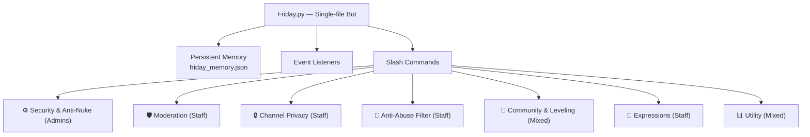

# 🤖 Friday — Discord Bot Documentation

> **Version:** 1.1 · **Library:** discord.py · **Language:** Python 3 · **Command Style:** Slash Commands (App Commands)
> **Source:** [`Friday.py`](file:///c:/Users/vinod/OneDrive/Desktop/Projects/Discord%20bot%20(Friday)/Friday.py)

---

## What is Friday?

Friday is a **general-purpose Discord bot** built with `discord.py`. She is designed to be a server's all-in-one security guard, moderator, and community engagement tool — all controlled through modern Discord **Slash Commands** (`/`).

Friday uses a **persistent JSON memory system** ([`friday_memory.json`](file:///c:/Users/vinod/OneDrive/Desktop/Projects/Discord%20bot%20(Friday)/friday_memory.json)) to save all settings, XP data, banned words, whitelists, reaction role configurations, and ignored privacy channels across restarts. Every setting is scoped **per-server (guild)**, so Friday can run on multiple servers simultaneously with independent configs.

---

## Architecture & Permissions Philosophy

Friday employs a strict, layered permissions model:
- **Administrators ONLY:** Critical infrastructure like Anti-Nuke security limits and toggles.
- **Staff (Moderators):** Day-to-day operations like Anti-Abuse chat filters, reaction panels, expressions, channel privacy, and direct moderation (kicks, bans, purges).
- **Everyone:** Fun commands, utility info, and leveling stats.



---

## 🗂️ Feature Breakdown

### 1. 🛡️ Moderation Commands
Standard moderation toolkit with **role hierarchy checks** — users cannot act on members with equal or higher roles (unless they are the server owner).

| Command | Description | Permission Required |
|---|---|---|
| `/ban @member [reason]` | Bans a member from the server | `Ban Members` |
| `/unban <user> [reason]` | Unbans a user by username, tag, or numeric ID (with live autocomplete) | `Ban Members` |
| `/warn @member [reason] [delivery]` | Issues formal warning with flexible dispatch (Both, DM Only, or Channel Chat) | `Moderate Members` |
| `/warnings @member` | Displays a member's active warning history with IDs and timestamps | `Moderate Members` |
| `/clearwarns @member [warn_id]` | Clears all warnings or a specific warning ID for a member | `Moderate Members` |
| `/timeout @member <minutes> [reason]` | Mutes a member for a duration | `Moderate Members` |
| `/untimeout @member [reason]` | Removes an active timeout early | `Moderate Members` |
| `/purge <amount>` | Bulk-deletes messages in the current channel | `Manage Messages` |
| `@Friday @member <nick>` | Mentions-based nickname changer (leave `<nick>` blank to reset) | `Manage Nicknames` |

---

### 2. ⚙️ Anti-Nuke, Anti-Raid & Security Command Center
Friday's flagship enterprise security architecture. Combines audit log tracking, message velocity filters, and instant action enforcement across three dedicated security tiers:
1. **Limit & Punish:** Enforces penalties (Ban, Kick, Strip Roles, Timeout) when destructive actions exceed thresholds in a 60s rolling window (Mass Ban, Mass Kick, Role Create/Delete, Channel Create/Delete, Mention Spam).
2. **Instant Punishment:** Enforces immediate penalties upon detection (Unauthorized Bot Add, Mass Pruning, Dangerous Admin Permissions, Vanity URL Change, Server Rename, Server Icon Change, Role/Channel Rename, Emoji Delete/Rename, Invite Delete).
3. **Detect Only:** Auto-deletes and silently logs Discord invite link spam and ghost pings.
4. **Anti-Raid System:** Tracks member join velocity. If joins exceed threshold (e.g. >5 joins in 10s), Friday engages auto-quarantine/lockdown and alerts `#audit-antiraid`.
5. **Anti-Spam System:** Detects message bursts (>5 msgs in 4s) or duplicate flood spam (>3 repeated messages), automatically purges messages, applies a 10-minute timeout, and alerts `#audit-antispam`.
6. **10 Dedicated Audit Channels:** Organizes logs under "Friday Security Logs" category across:
   `#audit-antiraid`, `#audit-antispam`, `#audit-roles`, `#audit-channels`, `#audit-antinuke`,
   `#audit-banned`, `#audit-deleted`, `#audit-timeouts`, `#audit-whitelisted`, `#audit-abuse`.

| Command | Description | Permission Required |
|---|---|---|
| `/antinuke_toggle <ON/OFF>` | Master switch enabling or disabling all automated security punishments | `Administrator` |
| `/antiraid <enable/disable>` | Toggle high-speed mass join velocity tracking & auto-quarantine | `Administrator` |
| `/antispam <enable/disable>` | Toggle rapid message burst & duplicate flood filter | `Administrator` |
| `/security_status` | Comprehensive status overview of all 10 security audit channels & matrices | `Administrator` |
| `/antinuke_limit <action> <limit>`| Sets threshold limits for destructive actions within 60 seconds | `Administrator` |
| `/antinuke_refresh` | Auto-creates the "Friday Security Logs" category and all 10 audit channels | `Administrator` |
| `/antinuke_sync` | Auto-scans and re-links existing security audit channels across the server | `Administrator` |
| `/whitelist_add @user` | Makes a user completely immune to anti-nuke, anti-raid, and anti-spam detection | `Administrator` |
| `/whitelist_remove @user` | Removes a user's security immunity | `Administrator` |

---

### 3. 🔒 Channel Privacy System
A powerful tool to lock down the server during raids, or simply manage private channels efficiently. Includes a failsafe so you don't accidentally lock members out of the entire server.

| Command | Description | Permission Required |
|---|---|---|
| `/private [channel]` | Makes a specific channel private (`@everyone` read = False) | `Manage Channels` |
| `/unprivate [channel] [all_channels]` | Unprivates a specific channel or ALL channels (Protects Security Logs) | `Manage Channels` |
| `/private_category <category>` | Makes an entire category and all its channels private | `Manage Channels` |
| `/unprivate_category <category>` | Unprivates a category and all its channels (Blocks Security Logs) | `Manage Channels` |
| `/ignore_private_add <channel>` | Adds a channel to the ignore list (won't be hit by force private) | `Manage Channels` |
| `/ignore_private_remove <channel>` | Removes a channel from the ignore list | `Manage Channels` |
| `/force_private` | Initiates Lockdown: Makes all channels private EXCEPT ignored channels, which become Read-Only so members can read but not chat. | `Manage Channels` |

---

### 4. 🤬 Anti-Abuse Chat Filter
A **real-time word filter** that scans every message (and edited messages via `on_message_edit`) against a per-server banned word list. Triggering it auto-deletes the message and alerts the `#audit-abuse` log channel.

| Command | Description | Permission Required |
|---|---|---|
| `/anti_abuse <words>` | Add words to the filter (comma-separated) | `Manage Messages` |
| `/anti_abuse_remove <word>` | Remove a specific word from the filter | `Manage Messages` |
| `/anti_abuse_list` | View all currently banned words | `Manage Messages` |
| `/anti_abuse_whitelist_add @user` | Make a user immune to the word filter | `Manage Messages` |
| `/anti_abuse_whitelist_remove @user`| Remove a user's immunity | `Manage Messages` |

---

### 5. 🎉 XP & Leveling System
Tracks message activity and rewards **15–40 XP per message** with a **60-second cooldown**.
Features **3 selectable Level-Up Notification Modes**:
- **Text Only:** Sends rich markdown congratulations message.
- **Image Card Only:** Generates and uploads a high-resolution PIL graphical milestone badge card.
- **Both (Text + Image Card):** Sends the custom text message together with the milestone card attached.

| Command | Description | Permission Required |
|---|---|---|
| `/level_setup #channel` | Activates leveling and sets the notification channel | `Manage Channels` |
| `/level_mode <text/image/both>` | Selects notification dispatch mode (Text, Image Card, or Both) | `Manage Channels` |
| `/rank [@user]` | Shows a visual rank card (custom generated image) | Everyone |
| `/leaderboard` | Displays the top 10 most active members | Everyone |

---

### 6. 🎨 Expressions — Emoji & Sticker Theft
Tools for staff to quickly populate the server with emojis and stickers.

| Command | Description | Permission Required |
|---|---|---|
| `/emoji_steal <emojis>` | Paste one or more custom emojis to bulk-steal them | `Manage Expressions` |
| **Right-Click → Steal Sticker** | Context menu on any message to steal its sticker | `Manage Expressions` |

---

### 7. 🎭 Reaction Roles
Create interactive role-assignment panels where users react to claim roles.

| Command | Description | Permission Required |
|---|---|---|
| `/reaction_panel` | Creates an embed panel with up to 3 emoji-role pairs | `Manage Roles` |

---

### 8. 🎫 Interactive Ticket System
Full-fledged interactive ticketing system with dynamic buttons, automated channel provisioning, and authenticated HTML transcript archiving:
- **Buttons Action Row:** Secondary Discord buttons with soft rounded corners (`border-radius: 8px`) and server emoji icons at the leading position.
- **Category Routing:** Creates isolated channels (`#ticket-001-general-support`) inside designated category.
- **Support Staff Role:** Automatically pinged and granted access upon opening.
- **Confidentiality:** Strict private channel isolation blocking public members.
- **Direct Transcript Text Channel:** Transcripts can be uploaded directly to a specified text channel or category fallback upon closing.
- **HTML Transcripts:** Authenticated standalone HTML files complete with creation/close timestamps, participant metadata, message history, and file attachments.

| Command | Description | Permission Required |
|---|---|---|
| `/ticket create_ticket_panel` | Deploys an interactive support panel with dynamic buttons | `Manage Channels` |
| `/ticket handle_role <role>` | Designates support staff role to be granted access and auto-pinged | `Manage Roles` |
| `/ticket add @user` | Grants a specific user access to an active ticket channel | `Manage Channels` |
| `/ticket remove @user` | Revokes access for a specific user from an active ticket channel | `Manage Channels` |

---

### 9. 📢 Self Announcements Dispatcher
| Command | Description | Permission Required |
|---|---|---|
| `/announcement <channel>` | Configures or overwrites the official announcement destination channel | `Manage Channels` |
| In-Chat Tag Shortcut | Reply to any draft announcement and tag `@Friday announcement kardo` / `@Friday announcement do it` to self-broadcast | `Manage Messages` |

---

### 10. 📊 Utility Commands
| Command | Description | Permission Required |
|---|---|---|
| `/bot_status` | Staff Dashboard: View Friday's current security and system status | `Manage Messages` |
| `/ping` | Shows bot latency confirmation | Everyone |
| `/serverinfo` | Displays server info, member counts, and creation date | Everyone |
| `/joke [category]` | Returns a hilarious Hinglish, Desi, or tech joke from a library of 420 jokes with interactive 'Next Joke 🔄' button | Everyone |
| `/help` | Full command reference organized by category | Everyone |
| `/sync` | Force-syncs global slash commands to the server | `Administrator` |

---

## 📦 Persistent Memory Schema

All data is stored in [`friday_memory.json`](file:///c:/Users/vinod/OneDrive/Desktop/Projects/Discord%20bot%20(Friday)/friday_memory.json) with this structure:

```json
{
    "nuke_settings":   { "guild_id": { "channel": 3, "ban": 5 } },
    "whitelist":       { "guild_id": [user_id, ...] },
    "antinuke_active": { "guild_id": true },
    "security_settings": {
        "guild_id": {
            "limits": { ... },
            "instant": { ... },
            "detect": { ... },
            "antiraid": { "enabled": true, "join_threshold": 5 },
            "antispam": { "enabled": true, "rate_limit": 5 }
        }
    },
    "server_logs":     { "guild_id": { "audit-deleted": channel_id, ... } },
    "banned_words":    { "guild_id": ["word1", "word2"] },
    "abuse_whitelist": { "guild_id": [user_id, ...] },
    "xp_data":         { "guild_id": { "user_id": { "xp": 150, "level": 2 } } },
    "level_channels":  { "guild_id": "channel_id" },
    "level_modes":     { "guild_id": "both" },
    "reaction_roles":  { "message_id": { "emoji_str": role_id } },
    "ignored_private": { "guild_id": [channel_id, ...] },
    "announcement_channels": { "guild_id": "channel_id" },
    "ticket_panels":   { "guild_id": { ... } },
    "ticket_support_roles": { "guild_id": role_id },
    "ticket_drafts":   { "guild_id": { ... } }
}
```

---

## 🌐 Web Control Center (Dashboard)

Accessible locally at `http://localhost:5000` when running [`main.py`](file:///c:/Users/vinod/OneDrive/Desktop/Projects/Discord%20bot%20(Friday)/main.py).

### Modules:
1. **🛡️ Security & Anti-Nuke Command Center:**
   - Master Anti-Nuke engine toggle.
   - Anti-Raid system hero card with join velocity rate thresholds.
   - Anti-Spam system hero card with burst message limits and flood control.
   - 10 live security channel status pills with single-click auto-creation & sync.
   - Limit & Punish matrix table (Ban, Kick, Role Create/Delete, Channel Create/Delete, Mention Spam).
   - Instant Punishment matrix table (Bot Add, Prune, Dangerous Admin Perms, Vanity Change, Server Rename, Server Icon, Role/Channel Rename, Emoji Delete/Rename, Invite Delete).
   - Detect Only matrix table (Invite Links, Ghost Ping).
   - Immunity Whitelist manager.
2. **🎉 Leveling & Rewards:**
   - 3-Way Mode Segmented Switch: Text Only, Image Card Only, or Both.
   - Custom template editor with single-line markdown headings (`#`, `##`, `###`), subtext (`-#`), bold, italic, spoilers, and dynamic variables (`{user}`, `{level}`).
   - Universal emoji picker with server custom emojis (static + animated GIFs) and standard emojis.
   - Real-time Discord chat simulator and live graphical milestone card simulation.
   - Live test message dispatcher to any server channel.
3. **💬 @ Mention Autocomplete System:**
   - Interactive popover appearing in all dashboard text editors when typing `@`.
   - Autocompletes members (`<@USER_ID>`), roles (`<@&ROLE_ID>`), `@everyone`, and `@here`.
   - Authentic Discord mention badges rendered in live simulators.
4. **🤬 Anti-Abuse Filter:**
   - Banned words tag manager (press Enter to ban).
   - Filter immunity whitelist selector.
5. **🔒 Channel & Category Privacy:**
   - **Global Lockdown:** Single-click server lockdown (hides all text channels except exempt channels, which turn Read-Only).
   - **Unlock All:** Restores default member permissions across the server.
   - **Individual Channel Privacy:** Lock (hide) or unlock (reveal) specific text channels.
   - **Category Privacy:** Lock or unlock entire categories and their channels with one click.
   - **Lockdown Exempt Channels:** Tag list of safe channels that stay visible during emergency lockdowns.
6. **🎭 Reaction Roles Deployer:**
   - Destination channel picker.
   - Custom panel title & description with markdown formatting and server/default emoji picker.
   - Dynamic role-emoji mapping builder (supports server static/animated emojis and standard emojis).
   - Live Discord embed preview with simulated reaction button pills.
   - One-click deployment and state restoration across syncs.
7. **📢 Announcements Dispatcher:**
   - Target destination channel selector & save.
   - Rich composer with server emojis, Discord markdown shortcut chips, notification pings (`@everyone`, `@here`, None), and customizable color theme accents.
   - Live simulator and one-click web broadcast.
8. **🎫 Interactive Ticket Dispatch Studio:**
   - Live 2-column studio layout with authentic Discord simulator.
   - Soft rounded action buttons (`border-radius: 8px`).
   - Destination text channel for direct transcript delivery.
   - Draft Save button for saving configurations without deploying.
   - Category provisioning and support role routing.
9. **🎵 Music & Audio Customizer:**
   - Full suite of editable custom responses for connection, disconnection, playback, pauses, skips, and queue notices in the Web Dashboard.
   - Live stream status synchronization.
10. **🔄 Universal State Persistence:**
   - State synchronization across all modules ensuring no form selections, drafts, or configs are reset upon clicking "Sync State".
   - Bot lifecycle management with clean shutdown.

---

### 9. 🎵 High-Fidelity Music & Audio Streaming (Pure YouTube Engine)

Friday features a built-in voice playback engine powered by `yt-dlp` and `FFmpeg`:
- **Strict YouTube Audio Search:** Searches and fetches audio exclusively from official YouTube releases using candidate relevance scoring (`official audio`, `music video`, verified artist channels). JioSaavn and SoundCloud fallbacks are completely removed to prevent unofficial covers or incorrect artist uploads.
- **Real-time Autocomplete:** Ultra-fast (<500ms) live song suggestions powered by Google search suggestion API.
- **Interactive Controller Views:** Clean, balanced 2-row button grid:
  - **Row 0:** `Pause / Resume`, `Skip`, `Shuffle`, `Loop`, `Stop (Danger Red)`
  - **Row 1:** `Queue`, `Like (Success Green)`, `Vol -`, `Vol +`
  - **Row 2:** DSP Equalizer Select Menu dropdown featuring 8 profiles (`Studio Master`, `Bass Boost`, `Vocal Boost`, `Nightcore`, `Lo-Fi`, `Treble Boost`, `8D Spatial Audio`, `Flat`).
- **Real-Time EQ Profile Switching:** Choosing an EQ filter switches the audio profile instantly in real time without restarting the track from 0:00 (seeks seamlessly at current playback timestamp using `-ss`).
- **Dashboard Custom Responses:** Every bot reply is customizable directly in the Web Control Center.

| Command | Description | Permission Required |
|---|---|---|
| `/join` | Connects Friday to the user's current voice channel | Everyone in VC |
| `/leave` | Stops playback, clears the queue, and disconnects Friday | Everyone in VC |
| `/play <music>` | Searches and streams audio exclusively from YouTube with live autocomplete and interactive UI | Everyone in VC |
| `/soundtest` | Plays a 2-second studio test chime to verify voice channel audio output | Everyone in VC |
| `/pause` | Pauses active playback | Everyone in VC |
| `/resume` | Resumes paused playback | Everyone in VC |
| `/skip` | Skips current track to next in queue | Everyone in VC |
| `/shuffle` | Shuffles upcoming tracks in the playlist queue | Everyone in VC |
| `/volume <percent>` | Adjusts master playback volume (1% to 200%) | Everyone in VC |
| `/queue` | Displays the current playlist and upcoming tracks in clean box format | Everyone |
| `/likes` | Displays your personal saved favorite tracks | Everyone |
| `/filter <preset>` | Sets audio EQ profile in real time without restarting track (8 DSP presets) | Everyone in VC |
| `/stop` | Halts playback and empties the playlist queue | Everyone in VC |

---

### 10. 💬 Mention Greeting Protocol

When a member tags `@Friday` alone (or with a simple greeting like `heyy` / `hi`):
- Friday responds with a sweet, casual girl-speak greeting that **directly tags the member** (`{user}`) and enables Discord reply mention.
- Randomly selected from a collection of **300 unique girl-speak greetings** in `data/greetings.json`.
- Greetings are strictly warm and declarative **without prompting questions** (no "how are you?" or "how's it going?"), ensuring users never mistake the bot for a conversational AI chatbot.

---

### 11. 🖼️ Media Only Channels

Friday can lock down specific channels to strictly enforce media-only contributions (showcase, memes, artwork):
- Any message posted without attachments (images, videos) by non-whitelisted members is immediately removed with a temporary warning notice.
- **Automatic Immunity:** Server Owners and Administrators (members with `Administrator`, `Manage Server`, or `Manage Channels`) are automatically immune and will never have their messages deleted.
- **Media Whitelist:** Staff can grant explicit exemption to specific members or server roles.

| Command | Description | Permission Required |
|---|---|---|
| `/media <action> [channel] [user] [role]` | Master media channel configuration (Set, Remove, List, Whitelist) | `Manage Channels` |
| `/media_whitelist_add [user] [role]` | Exempts a specific member or role from media-only deletion | `Manage Channels` |
| `/media_whitelist_remove [user] [role]` | Revokes media-only chat exemption from a member or role | `Manage Channels` |
| `/media_whitelist_list` | Displays all currently whitelisted members and roles | `Manage Channels` |

---

### 12. 📦 Command Box Formatting & Monochrome Aesthetics

- All Discord command responses have been standardized from raw text with cartoon emojis into sleek dark box embeds (`response_utils.py`).
- Cartoon emojis (`🔨`, `❌`, `✅`, `🔇`, `🧹`) have been replaced with elegant monochrome geometric symbols (`✓`, `✕`, `▲`, `◈`, `♫`, `⬡`).
- The Web Dashboard Custom Responses interface (`dashboard.html`) features matching black-and-white SVGs and box-format defaults while preserving all system identifiers.

---

> *Document updated on October 14, 2026*


